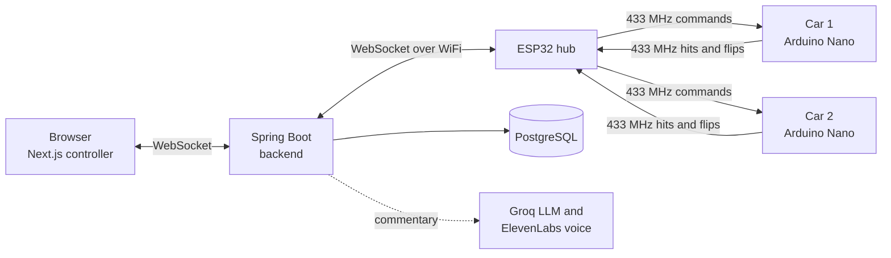

# BattleCars

Two remote controlled robot cars fight each other in a small arena while players drive them from a browser. Every hit is picked up by a sensor on the car, travels over radio and WiFi to the server, takes health off the car that was hit, and gets a live AI commentary line read out loud. The first car to run out of health loses.

This was our team project for the IT Integration Project at UCLL in Leuven. The course is about getting hardware, a backend, a frontend and a database to work together as one system, and that is exactly where most of the hard problems were.

## My role

I was the IoT Engineer on the team. I built the two cars and the hub, wrote all of the firmware, and designed how the hardware talks to the rest of the system:

- the radio protocol between the hub and the cars,
- the hub that bridges the WebSocket backend and the 433 MHz radio,
- hit and flip detection with an accelerometer on each car,
- the safety behaviour that stops a car when it loses contact,
- the wiring of both the hub and the cars.

The backend, frontend and database were built by the rest of the team. Everything under [`firmware/`](firmware) is my work.

## How it works



1. A player presses a key in the browser, which sends a command such as `1:UP` over a WebSocket.
2. The backend checks that it is a valid command and forwards it to the hub.
3. The hub turns it into a radio code and sends it to the right car on its own 433 MHz transmitter.
4. The car drives, and keeps watching its accelerometer. A sudden jolt counts as a hit, and lying upside down counts as flipped.
5. The car radios hits and its orientation back to the hub, which sends them to the backend as JSON.
6. The backend takes 10 health off the car that was hit, stores the reading in PostgreSQL, updates both browsers, and asks an LLM for a commentary line that is turned into speech.

The cars only listen to radio, so the WiFi and server side never has to reach them directly. The hub is the single point where the network world meets the radio world.

## Hardware

| Part | Hub | Each car |
| --- | --- | --- |
| Microcontroller | ESP32 DevKit | Arduino Nano (ATmega328P) |
| Radio | Two 433 MHz transmitters (one per car) and one 433 MHz receiver | One 433 MHz receiver and one transmitter |
| Display | 128x64 OLED (I2C) showing WiFi, backend and command status | 128x64 OLED showing commands, hits and sensor status |
| Sensors | | MPU accelerometer over I2C for hits and flips |
| Drive | | Motors through L298N drivers, eight control pins |
| Weapon | | Servo hammer on car 1 |
| Power | USB | 6 V battery pack (4x AA) to the Nano and the motor driver |

Wiring diagrams: [hub](firmware/wiring/hub-wiring.png) and [car](firmware/wiring/car-wiring.png). Known hardware risks are written down in [wiring-notes.md](firmware/wiring/wiring-notes.md).

## Firmware

### One protocol, shared by both sides

The radio codes live in one header, [`BattleCarsProtocol.h`](firmware/shared/BattleCarsProtocol/BattleCarsProtocol.h), that the hub and the cars both include, so the two sides can never disagree about what a code means.

| Direction | Message | Car 1 | Car 2 |
| --- | --- | --- | --- |
| Hub to car | UP, DOWN, LEFT, RIGHT, STOP | 11 to 15 | 21 to 25 |
| Hub to car | HAMMER | 16 | not fitted |
| Car to hub | Upright | 91 | 101 |
| Car to hub | Flipped | 92 | 102 |
| Car to hub | Hit | 51 | 61 |

Command codes follow `car id x 10 + command`, which keeps decoding to a range check.

### One car firmware, two cars

Both cars run the same code. The car is picked at build time with a PlatformIO environment, so a fix only has to be made once:

```bash
pio run -d firmware/car -e car1 -t upload   # car 1, with hammer
pio run -d firmware/car -e car2 -t upload   # car 2
```

### Staying safe when things go wrong

A battle robot that keeps driving after it loses contact is a real problem, so the firmware assumes the link will fail:

- **Dead man's switch.** A car stops its motors if it has not received a command for 1.2 seconds. Pressing a key drives the car and releasing it sends STOP, so even if that STOP gets lost over the radio, the car still stops by itself.
- **Hub failsafe.** When the hub loses its connection to the backend, it sends STOP to both cars straight away.
- **Validated commands.** The backend only forwards commands that match a strict pattern, and the hub parses them again with a length limit. Anything else is logged and dropped.
- **Sensor errors are visible.** If the accelerometer stops answering, the car shows it on its display, stops counting hits so a loose wire cannot fake them, and keeps trying to reconnect it.
- **Rate limits.** Hits have a cooldown on the car and on the hub, so one crash is one hit.
- **WiFi recovery.** The hub reconnects to WiFi on its own and restarts if it cannot get back on the network within a minute.

### Radio is half duplex

The cars share one 433 MHz band for sending and receiving, and a transmission blocks the small Nano for a moment. To avoid talking over the hub, a car sends its telemetry when it stops. A hit that happens while driving is remembered and sent as soon as the car stops.

## Software stack

| Part | Technology |
| --- | --- |
| Hub firmware | C++, Arduino on ESP32, WebSockets, ArduinoJson, rc-switch |
| Car firmware | C++, Arduino on ATmega328P, rc-switch, Servo, SSD1306Ascii |
| Backend | Java 21, Spring Boot 3.5, Spring WebSocket, Spring Data JPA, Spring Security |
| Frontend | Next.js 16, React 19, TypeScript, Tailwind CSS |
| Database | PostgreSQL 16 |
| Commentary | Groq (Llama 3.3 70B) for text, ElevenLabs for speech, both optional |
| Tooling | PlatformIO, Maven, Docker Compose, GitHub Actions |

## Running it

You need Docker for the server side, and PlatformIO for the hardware.

```bash
cp .env.example .env          # set APP_PASSWORD, the AI keys are optional
docker compose up --build
```

The game runs on http://localhost:3000 (log in with `APP_PASSWORD`) and the backend on http://localhost:8080. Without the AI keys the game works the same, just without commentary.

To flash the hub, copy the example config and fill in your WiFi and the address of the machine running the backend:

```bash
cp firmware/hub/include/config.example.h firmware/hub/include/config.h
pio run -d firmware/hub -t upload
```

Set `WS_USE_SSL` to `1` when the backend is behind HTTPS. Then flash both cars with the commands above.

The demo database comes with six example players, for example `Angelo` with the password `angelo123`. The full list is in [`DbInitializer.java`](backend/src/main/java/be/ucll/repository/DbInitializer.java).

## Tests and CI

GitHub Actions runs three pipelines, each only when its part of the repo changes:

- **Backend:** unit tests for the game rules, players, sensor parsing and the WebSocket bridge, plus integration tests for the whole match lifecycle against a real PostgreSQL.
- **Frontend:** lint, type check and production build.
- **Firmware:** builds car 1, car 2 and the hub with PlatformIO, so a change that breaks the hardware code is caught before it reaches a car.

## Repository layout

```
firmware/
  shared/       Radio protocol used by the hub and the cars
  hub/          ESP32 hub: WiFi, WebSocket, radio, OLED
  car/          Arduino Nano car firmware, built as car1 or car2
  wiring/       Wiring diagrams and hardware notes
backend/        Spring Boot API, WebSocket bridge, game logic, AI commentary
frontend/       Next.js lobby, controller, leaderboard and player management
docker-compose.yml
```

## Known limitations

- The cars are wired on breadboards with unsoldered radio antennas, so vibration can loosen wires and range is short. A PCB would be the next step.
- Hit detection uses one threshold for the total jolt, so it cannot tell a hit from a hard crash into a wall, and it does not know which car was the attacker.
- The site is protected by one shared password, and the backend trusts the network it runs on. The hub identifies itself with a query parameter instead of a secret. This was fine for a demo on the school network but would need real authentication anywhere else.

## Team

Built by a team of UCLL Applied Computer Science students as the IT Integration Project, 2025 to 2026. I was the IoT Engineer and owned the hardware and firmware.
