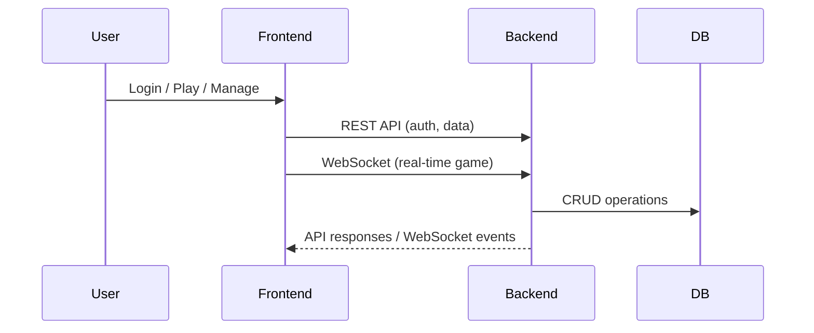

# BattleCars Project

## Project Setup & Architecture Documentation

### 1. Setup Instructions

#### Backend
- **Requirements:** Java 17+, Maven, Docker (for DB)
- **Run locally:**
  1. `cd backend`
  2. `mvn clean install`
  3. `mvn spring-boot:run`
- **Environment Variables:**  
  - `SPRING_DATASOURCE_URL` (e.g., `jdbc:postgresql://localhost:5432/battlecars`)
  - `SPRING_DATASOURCE_USERNAME`
  - `SPRING_DATASOURCE_PASSWORD`
- **Docker:**  
  - See below for database setup.

#### Frontend
- **Requirements:** Node.js 18+, npm
- **Run locally:**
  1. `cd frontend`
  2. `npm install`
  3. `npm run dev`
- **Environment Variables:**  
  - `NEXT_PUBLIC_API_URL` (e.g., `http://localhost:8080`)

#### Database (PostgreSQL)
- **Run with Docker:**
  ```sh
  docker run --name battlecars-db -e POSTGRES_DB=battlecars -e POSTGRES_USER=youruser -e POSTGRES_PASSWORD=yourpass -p 5432:5432 -d postgres:15
  ```
- Update backend `.properties` with your DB credentials.

#### Supporting Services
- **WebSocket:** Handled by backend (`/ws` endpoint).
- **Reverse Proxy (optional):** Use Nginx or Caddy for production.

---

### 2. Architecture Overview

#### Major Components
- **Frontend:** Next.js app (TypeScript), communicates with backend via REST and WebSocket.
- **Backend:** Spring Boot (Java), exposes REST API and WebSocket endpoints, handles business logic, persists to PostgreSQL.
- **Database:** PostgreSQL, stores users, matches, sensor data, etc.

#### Main Flows


---

### 3. Technical Decisions

- **Spring Boot** for rapid backend development and WebSocket support.
- **Next.js** for SSR/SPA flexibility and TypeScript support.
- **PostgreSQL** for relational data and Docker for easy local setup.
- **WebSocket** for real-time game updates.
- **Environment variables** for configuration (no secrets in code).
- **Docker** for DB to ensure consistent local/prod environments.

---

### 4. Required Environment Variables

| Variable                      | Description                        | Example Value                      |
|-------------------------------|------------------------------------|------------------------------------|
| SPRING_DATASOURCE_URL         | JDBC URL for DB                    | jdbc:postgresql://localhost:5432/battlecars |
| SPRING_DATASOURCE_USERNAME    | DB username                        | youruser                           |
| SPRING_DATASOURCE_PASSWORD    | DB password                        | yourpass                           |
| NEXT_PUBLIC_API_URL           | Backend API base URL (frontend)    | http://localhost:8080              |

---
